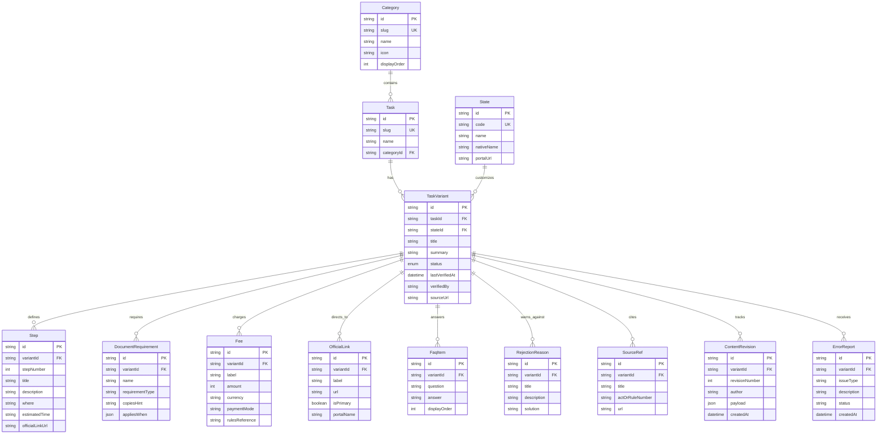
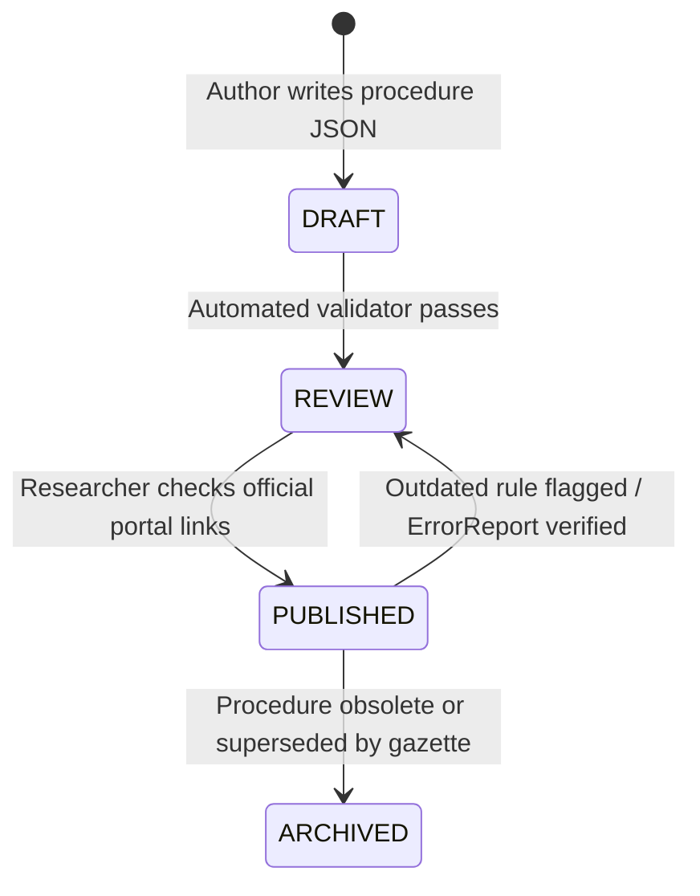

# Data Architecture & Entity Relationship Diagram

This document describes the structured database schema for the **India Paperwork Guide** civic platform, implemented in `prisma/schema.prisma`.

## Core Architectural Principles

1. **National Default vs State Variants**:
   - Each `Task` represents a national procedure (e.g. `driving-licence-learner`, `passport-renewal`).
   - A `TaskVariant` with `stateId = null` acts as the **National Default**.
   - A `TaskVariant` linked to a `State` (e.g. `Gujarat` / `GJ`) contains state-specific document rules, local fees, and designated sub-registrar/RTO portal links.

2. **Verification & Freshness Audit Trail**:
   - Every content row carries `status` (`DRAFT`, `REVIEW`, `PUBLISHED`, `ARCHIVED`), `lastVerifiedAt`, `verifiedBy`, and official `sourceUrl`.

3. **Conditional Document Logic**:
   - `DocumentRequirement` stores a JSON rule in `appliesWhen` (e.g., `{"applicantAge": {"lt": 18}}` or `{"vehicleType": "commercial"}`).

---

## Mermaid Entity Relationship Diagram

---

## Verification & Status Workflow

